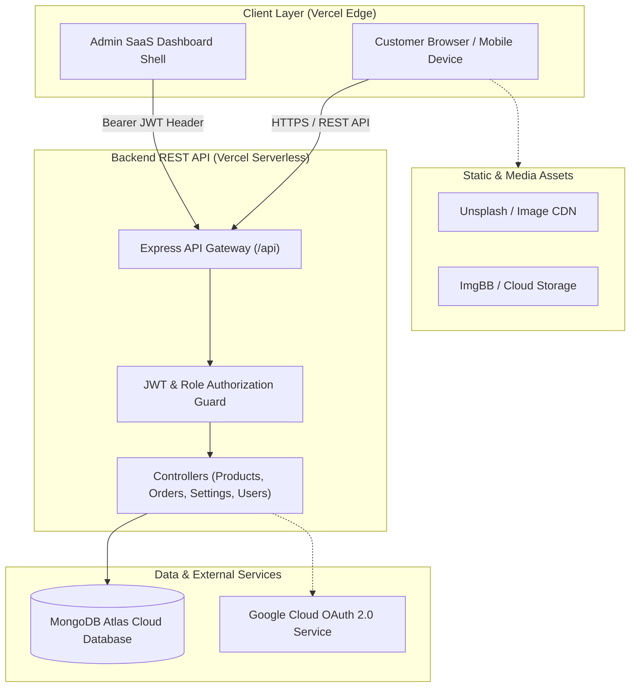

<div align="center">

# 💎 StyleHub — Luxury Fashion E-Commerce Platform
**A Next-Generation, Enterprise-Grade MERN Stack E-Commerce Solution Built for Premium Fashion Retailers.**
<p align="center">
 <a href="https://style-hub-brown.vercel.app/" target="_blank">
  
</a>
</p>

  <p align="center">
    <strong>An intuitive e-commerce platform delivering a lightning-fast shopping experience across all devices. It empowers customers with highly secure, worry-free logins and offers store owners a simplified dashboard for effortless business management.</strong>
  </p>


[](https://style-hub-brown.vercel.app/)
[](https://style-hub-server-psi.vercel.app/api/health)
[](https://style-hub-brown.vercel.app/)
[](LICENSE)

<br/>

[Explore Live Storefront](https://style-hub-brown.vercel.app/) • [API Health Monitor](https://style-hub-server-psi.vercel.app/api/health) • [Key Features](#-key-features) • [Tech Stack](#-technology-stack) • [API Reference](#-restful-api-reference) • [Setup Guide](#-local-installation--setup)

</div>

---

## 📖 Executive Summary

**StyleHub** is a production-ready, full-stack enterprise e-commerce platform engineered by **Bengal IT** for high-end fashion and lifestyle brands. Designed with a luxury-first visual language inspired by modern haute couture, the application delivers fluid micro-interactions, responsive high-conversion checkout flows, and a comprehensive cloud administration suite.

The system combines **React 19**, **Tailwind CSS v4**, and **Vite 8** on the frontend with a modular **Node.js / Express** RESTful API backed by **MongoDB Atlas** and **Google OAuth 2.0**. It supports real-time catalog management, dynamic order tracking, hybrid guest/authenticated checkout, multi-tier Bangladeshi payment gateways (bKash, Nagad, Rocket, COD), and a full-featured admin CMS control plane.

---

## 🌟 Key Highlights & Architectural Differentiators

```
┌────────────────────────────────────────────────────────────────────────┐
│                        StyleHub Ecosystem                              │
├────────────────────────────────┬───────────────────────────────────────┤
│ 🛍️ Customer Experience        │ ⚙️ Enterprise Admin Suite (SaaS Shell) │
│ • High-FPS Video Hero Section  │ • Executive KPI & Sales Analytics     │
│ • Lenis Smooth Inertial Scroll │ • Real-Time Order Lifecycle Manager   │
│ • Multi-Variant Quick View     │ • Dynamic Product Catalog & Inventory │
│ • Slide-over Cart & Wishlist   │ • Customer Directory & Role Controls  │
│ • Frictionless BDT Checkout    │ • Live Store CMS (Hero, Sliders, FAQs)│
│ • Dual Auth (JWT + Google)     │ • Dynamic Payment & Shipping Settings │
└────────────────────────────────┴───────────────────────────────────────┘
```

---

## 🚀 Live Deployments

| Component | Provider | Live URL | Status |
| :--- | :--- | :--- | :--- |
| **Frontend Storefront** | Vercel Edge | [https://style-hub-brown.vercel.app/](https://style-hub-brown.vercel.app/) | `● Active / Production` |
| **Backend REST API** | Vercel Serverless | [https://style-hub-server-psi.vercel.app/api](https://style-hub-server-psi.vercel.app/api) | `● Active / Production` |
| **API Health Check** | Microservice | [https://style-hub-server-psi.vercel.app/api/health](https://style-hub-server-psi.vercel.app/api/health) | `● Healthy (200 OK)` |
| **Database Cluster** | MongoDB Atlas | *Cloud Multi-Region Cluster (TLS 1.3)* | `● Connected` |

---

## 🎯 Key Features

### 1. 🛍️ Customer Storefront & Shopping Experience
* **Cinematic Video & Slider Hero:** Seamless auto-playing high-definition video banner with luxury typography, CTA actions, and seasonal promotions.
* **Smart Filter & Search:** Real-time catalog navigation filtering by category (Men, Women, Panjabi, T-Shirts, Formal), price brackets, tags, discount badges, and stock availability.
* **Instant Quick-View Modal:** Interactive modal allowing customers to inspect high-resolution galleries, select sizes (`S`, `M`, `L`, `XL`), pick color swatches, and add to cart without leaving the page.
* **Slide-over Drawers:**
  * **Cart Drawer:** Real-time subtotal calculation, quantity steppers, shipping estimates, and instant checkout link.
  * **Wishlist Drawer:** One-click heart toggle with persistent cloud and local sync.
* **Frictionless Checkout Flow:**
  * Support for both **Guest Checkout** (instant order without mandatory sign-up) and **Authenticated User Orders**.
  * Dynamic Bangladeshi shipping fee calculation (Inside Dhaka ৳60 / Outside Dhaka ৳120 or custom config).
  * Multiple payment options: **Cash on Delivery (COD)**, **bKash**, **Nagad**, **Rocket**, and **Bank Transfer**.
  * Auto-generated order tracking tokens and invoice receipts.
* **Micro-Interactions & Motion:** Powered by **Lenis** smooth inertial scrolling and **Tailwind CSS v4** hardware-accelerated transitions.

### 2. 👤 User Account & Self-Service Portal
* **Dual Authentication System:**
  * Email & Password with Bcrypt salt encryption and JWT token storage.
  * Google OAuth 2.0 One-Tap / Button sign-in using official Google Auth APIs.
* **Customer Dashboard:**
  * Personal profile management (avatar upload, phone, shipping addresses).
  * Order History with multi-stage status tracking (`Pending` ➔ `Processing` ➔ `Shipped` ➔ `Delivered` ➔ `Cancelled`).
  * Personal Wishlist and Collections manager.
  * Interactive Notification Center with unread counters and real-time alerts.

### 3. 🛡️ Enterprise Admin Suite (Back-Office CMS)
* **Overview & KPI Analytics:**
  * Real-time metrics: Gross Revenue (BDT), Net Orders, Total Customers, Low-Stock Alerts.
  * Recent activity feed and quick action dispatchers.
* **Product & Inventory Management:**
  * Complete CRUD for products with multi-image gallery support (Base64 / CDN URLs).
  * Variant management: sizes, color swatches, discount percentages, strike-through pricing, and stock counter.
* **Order Management System (OMS):**
  * Real-time order monitoring with customer contact info, delivery notes, and purchased line items.
  * Status workflow updater (`Pending` to `Delivered`) and order cancellation/deletion guards.
* **Customer & Role Management:**
  * Comprehensive directory of registered users with order histories.
  * Role elevation and permission controls (`user` ↔ `admin`).
* **Review Moderation Hub:**
  * Moderate buyer ratings, approve/feature verified reviews, and reply to client inquiries.
* **Live Store CMS & Global Settings:**
  * **Shipping Rates:** Configurable Inside/Outside Dhaka delivery fees.
  * **Payment Gateway Hub:** Toggle active payment methods, edit merchant numbers, and provide payment instructions (e.g. bKash Merchant / Personal numbers).
  * **Dynamic Homepage CMS:** Modify Hero banners, promotional marketing banners, Trust Badges, and FAQs live from the dashboard without code re-deployment.

---

## 🛠️ Technology Stack

```
Frontend Architecture                     Backend Architecture
─────────────────────────────────         ─────────────────────────────────
React 19.2 (Concurrent Mode)              Node.js v18+ Runtime
Vite 8.2 (ESBuild Bundler)                Express.js 4.21 REST Framework
Tailwind CSS v4 (PostCSS Engine)          MongoDB Atlas / Mongoose 8.9 ODM
Lenis 1.3 (Inertial Smooth Scroll)        JWT (JSON Web Token) Security
Lucide React (Feather Icons)              Bcrypt.js Password Hashing
React Router DOM v7 (Client Routing)      Google Auth Library (OAuth 2.0)
React Toastify (Notification UI)          Morgan HTTP Request Logger
```

---

## 📐 System Architecture Diagram



---

## 📁 Repository Structure

```
StyleHub-project/
├── Backend/                            # Node.js & Express REST API Server
│   ├── src/
│   │   ├── config/
│   │   │   └── db.js                   # Cached MongoDB Atlas connection handler
│   │   ├── controllers/                # Business logic controllers
│   │   │   ├── analyticsController.js  # Revenue, orders & store KPI data
│   │   │   ├── attributeController.js  # Product attributes management
│   │   │   ├── authController.js       # Register, login, Google OAuth, users
│   │   │   ├── brandController.js      # Brand partner logos CRUD
│   │   │   ├── categoryController.js   # Dynamic category management
│   │   │   ├── myCollectionController.js # Wishlist & personal collections
│   │   │   ├── notificationController.js # Real-time user alerts
│   │   │   ├── orderController.js      # Order placement & fulfillment
│   │   │   ├── productController.js    # Catalog, filters, search & inventory
│   │   │   ├── reviewController.js     # Customer reviews & ratings
│   │   │   ├── settingController.js    # Store CMS, shipping & payment methods
│   │   │   └── tagController.js        # Product tags management
│   │   ├── data/
│   │   │   └── productsSeed.js         # Production initial data seed
│   │   ├── middleware/
│   │   │   ├── authMiddleware.js       # Protect & Admin permission guards
│   │   │   └── errorMiddleware.js      # 404 & Centralized error handler
│   │   ├── models/                     # Mongoose Schema Definitions
│   │   │   ├── Attribute.js
│   │   │   ├── Brand.js
│   │   │   ├── Category.js
│   │   │   ├── MyCollection.js
│   │   │   ├── Notification.js
│   │   │   ├── Order.js
│   │   │   ├── Product.js
│   │   │   ├── Review.js
│   │   │   ├── StoreSettings.js        # Global CMS schema
│   │   │   ├── Tag.js
│   │   │   └── User.js
│   │   ├── routes/                     # Express Router modules
│   │   └── seeder.js                   # CLI Database Seeding utility
│   ├── .env.example                    # Backend environment template
│   ├── server.js                       # Express app entry & middleware setup
│   ├── vercel.json                     # Vercel Serverless deployment config
│   └── package.json
│
├── Frontend/                           # React 19 + Vite + Tailwind CSS v4
│   ├── public/                         # Public assets & brand vector icons
│   ├── src/
│   │   ├── assets/                     # Static graphics and hero images
│   │   ├── components/                 # Reusable UI component library
│   │   │   ├── admin/                  # Admin back-office views
│   │   │   │   ├── AdminAddProduct.jsx # Product publishing form
│   │   │   │   ├── AdminAnalytics.jsx  # Sales charts & business intelligence
│   │   │   │   ├── AdminCustomers.jsx  # Customer list & role manager
│   │   │   │   ├── AdminOrders.jsx     # Order fulfillment manager
│   │   │   │   ├── AdminOverview.jsx   # Executive metric dashboard
│   │   │   │   ├── AdminProducts.jsx   # Product table & inventory
│   │   │   │   ├── AdminReviews.jsx    # Review moderation & approval
│   │   │   │   ├── AdminSettings.jsx   # Payments, shipping & CMS controls
│   │   │   │   └── AdminSidebar.jsx    # Administrative navigation
│   │   │   ├── dashboard/              # Shared dashboard topbar
│   │   │   ├── user/                   # Customer dashboard views
│   │   │   ├── CartDrawer.jsx          # Slide-out interactive cart
│   │   │   ├── WishlistDrawer.jsx      # Slide-out wishlist
│   │   │   ├── HeroVideoSection.jsx    # Video banner hero section
│   │   │   ├── HeroSlider.jsx          # Alternate image carousel hero
│   │   │   ├── ProductQuickViewModal.jsx # Quick view preview modal
│   │   │   ├── Navbar.jsx              # Responsive header navigation
│   │   │   ├── Footer.jsx              # Comprehensive brand footer
│   │   │   ├── CategoryCircles.jsx     # Circular category explorer
│   │   │   ├── TrendingProducts.jsx    # Featured product carousel
│   │   │   ├── PromoBanners.jsx        # Editorial promo banners
│   │   │   ├── CustomerReviews.jsx     # Testimonial carousel
│   │   │   ├── FAQSection.jsx          # Dynamic accordion FAQ
│   │   │   └── SmoothScroll.jsx        # Lenis smooth scroll engine
│   │   ├── config/
│   │   │   └── api.js                  # Dynamic API base URL switcher
│   │   ├── context/
│   │   │   ├── AuthContext.jsx         # User authentication & token state
│   │   │   ├── ShopContext.jsx         # Cart, Wishlist, Filter, Products state
│   │   │   └── SiteSettingsContext.jsx # Live store settings & payment config
│   │   ├── pages/                      # Page view controllers
│   │   │   ├── HomePage.jsx
│   │   │   ├── ShopPage.jsx
│   │   │   ├── ProductDetailsPage.jsx
│   │   │   ├── CategoriesPage.jsx
│   │   │   ├── CheckoutPage.jsx
│   │   │   ├── LoginPage.jsx
│   │   │   ├── RegisterPage.jsx
│   │   │   ├── DashboardPage.jsx
│   │   │   ├── AboutPage.jsx
│   │   │   └── NotFoundPage.jsx
│   │   ├── App.jsx                     # Route definitions & layout wrappers
│   │   ├── main.jsx                    # React 19 root bootstrap
│   │   └── index.css                   # Tailwind CSS v4 theme variables
│   ├── package.json
│   └── vite.config.js
│
└── README.md                           # Project Documentation
```

---

## 📡 RESTful API Reference

All backend API routes are prefixed with `/api`. Protected routes require a valid Bearer token passed in the `Authorization` header: `Authorization: Bearer <TOKEN>`.

### 1. Authentication & Users (`/api/auth`)
| Method | Endpoint | Access | Description |
| :--- | :--- | :--- | :--- |
| `POST` | `/api/auth/register` | Public | Register new customer account |
| `POST` | `/api/auth/login` | Public | Authenticate user with Email & Password |
| `POST` | `/api/auth/google` | Public | Authenticate via Google OAuth credential token |
| `GET` | `/api/auth/me` | Protected (User) | Fetch current authenticated user profile |
| `PUT` | `/api/auth/profile` | Protected (User) | Update user profile, phone, address, and avatar |
| `GET` | `/api/auth/users` | Protected (Admin) | Retrieve full customer directory |
| `PUT` | `/api/auth/users/:id/role` | Protected (Admin) | Update user role (`user` / `admin`) |
| `DELETE`| `/api/auth/users/:id` | Protected (Admin) | Delete user account |

### 2. Products & Catalog (`/api/products`)
| Method | Endpoint | Access | Description |
| :--- | :--- | :--- | :--- |
| `GET` | `/api/products` | Public | Get products with search, category, sort & pagination |
| `GET` | `/api/products/:id` | Public | Get single product details by ID or Slug |
| `GET` | `/api/products/categories/list` | Public | Get distinct product categories |
| `POST` | `/api/products` | Protected (Admin) | Create a new product listing |
| `PUT` | `/api/products/:id` | Protected (Admin) | Update existing product details & inventory |
| `DELETE`| `/api/products/:id` | Protected (Admin) | Delete product from catalog |

### 3. Orders & Checkout (`/api/orders`)
| Method | Endpoint | Access | Description |
| :--- | :--- | :--- | :--- |
| `POST` | `/api/orders` | Public / User | Place an order (supports Guest & Logged-in checkout) |
| `GET` | `/api/orders/myorders` | Protected (User) | Get orders belonging to authenticated user |
| `GET` | `/api/orders` | Protected (Admin) | Get all customer orders across the platform |
| `PUT` | `/api/orders/:id/status` | Protected (Admin) | Update order status (`Pending` ➔ `Delivered`) |
| `DELETE`| `/api/orders/:id` | Protected (Admin) | Remove order record |

### 4. Store CMS & Settings (`/api/settings`)
| Method | Endpoint | Access | Description |
| :--- | :--- | :--- | :--- |
| `GET` | `/api/settings` | Public | Retrieve active store configuration, shipping & payments |
| `PUT` | `/api/settings` | Protected (Admin) | Update general store info, shipping rates, and CMS |
| `POST` | `/api/settings/reset-defaults` | Protected (Admin) | Reset configuration to system defaults |
| `POST` | `/api/settings/payment-methods` | Protected (Admin) | Add custom payment method (e.g. bKash / Nagad) |
| `PUT` | `/api/settings/payment-methods/:id` | Protected (Admin) | Toggle or edit payment gateway info |
| `DELETE`| `/api/settings/payment-methods/:id`| Protected (Admin) | Remove payment gateway |

### 5. Collections & Wishlist (`/api/my-collections`)
| Method | Endpoint | Access | Description |
| :--- | :--- | :--- | :--- |
| `GET` | `/api/my-collections` | Protected (User) | Get authenticated user's wishlist items |
| `POST` | `/api/my-collections/wishlist/toggle` | Protected (User) | Toggle product in/out of user wishlist |
| `DELETE`| `/api/my-collections/clear/:type` | Protected (User) | Clear entire wishlist or cart collection |

### 6. Analytics & Health (`/api/analytics` & `/api/health`)
| Method | Endpoint | Access | Description |
| :--- | :--- | :--- | :--- |
| `GET` | `/api/health` | Public | Health monitor, uptime, and server environment |
| `GET` | `/api/db-status` | Public | Diagnostics check for MongoDB Atlas connectivity |
| `GET` | `/api/analytics` | Public / Admin | Aggregated sales volume, order counters & revenue |

---

## 💻 Local Installation & Setup

Follow these instructions to run both the backend server and frontend client locally on your development machine.

### Prerequisites
* **Node.js**: v18.0.0 or higher
* **npm** or **yarn**
* **MongoDB**: A free MongoDB Atlas cluster URI or local MongoDB daemon
* **Git**

### 1. Clone the Repository
```bash
git clone https://github.com/eyasinarafat3485-gif/Style-Hub.git
cd Style-Hub
```

---

### 2. Backend Setup
1. Navigate to the backend directory:
   ```bash
   cd Backend
   ```

2. Install dependencies:
   ```bash
   npm install
   ```

3. Configure Environment Variables:
   Create a `.env` file in the `Backend/` directory:
   ```env
   PORT=5000
   NODE_ENV=development
   CLIENT_URL=http://localhost:5173

   # MongoDB Connection
   MONGO_URI=mongodb+srv://<username>:<password>@cluster0.mongodb.net/stylehub?retryWrites=true&w=majority

   # JWT Security
   JWT_SECRET=super_secret_production_ready_jwt_key_here
   JWT_EXPIRES_IN=7d

   # Optional Google OAuth 2.0 Credentials
   GOOGLE_CLIENT_ID=your_google_client_id_here
   GOOGLE_CLIENT_SECRET=your_google_client_secret_here
   ```

4. *(Optional)* Seed Demo Products:
   ```bash
   npm run seed
   ```

5. Start the Backend Server:
   ```bash
   npm run dev
   ```
   *The server will run on: `http://localhost:5000`*

---

### 3. Frontend Setup
1. Open a new terminal and navigate to the frontend directory:
   ```bash
   cd ../Frontend
   ```

2. Install dependencies:
   ```bash
   npm install
   ```

3. Configure Frontend Environment (Optional):
   Create a `.env` file in `Frontend/`:
   ```env
   VITE_API_URL=http://localhost:5000/api
   ```
   *(If omitted, the frontend automatically defaults to `http://localhost:5000/api` when running locally).*

4. Launch Vite Development Server:
   ```bash
   npm run dev
   ```
   *The storefront will be available at: `http://localhost:5173`*

---

## 🔒 Security & Performance Engineering

* **JWT Token Authorization:** Authenticated requests pass tokens in standard Bearer headers, protected by cryptographically salted password hashes via `bcryptjs`.
* **CORS & Origin Whitelisting:** Dynamic origin verification allows strictly permitted domains in production while accommodating development environments.
* **Request Payload Guardrails:** 10MB payload ceiling to handle high-resolution image uploads safely without memory exhaustion.
* **Optimized Serverless Connection Pooling:** Implements MongoDB connection caching across warm serverless functions to prevent connection storms on Vercel.
* **Component Code-Splitting:** Dynamic imports and modular React 19 tree-shaking for sub-second first-contentful paint (FCP).

---

## 🚢 Deployment Architecture

### Frontend (Vercel Edge Deployment)
The frontend is hosted on **Vercel** with continuous deployment from the repository:
* **Framework Preset:** Vite
* **Build Command:** `npm run build`
* **Output Directory:** `dist`

### Backend (Vercel Serverless Function)
The backend is packaged as a serverless REST API using `vercel.json`:
```json
{
  "version": 2,
  "builds": [
    {
      "src": "server.js",
      "use": "@vercel/node"
    }
  ],
  "routes": [
    {
      "src": "/(.*)",
      "dest": "server.js"
    }
  ]
}
```

---

## 🏢 Client & Agency Credits

| Entity | Details |
| :--- | :--- |
| **Project Name** | **StyleHub** (Luxury E-Commerce & Retail Suite) |
| **Engineering Agency** | **Bengal IT** |
| **Target Market** | Bangladesh & Global Fashion Retail |
| **Live Storefront** | [https://style-hub-brown.vercel.app/](https://style-hub-brown.vercel.app/) |
| **Production API** | [https://style-hub-server-psi.vercel.app/](https://style-hub-server-psi.vercel.app/) |
| **Development Team** | Full-Stack Engineering Team @ Bengal IT |

---

## 📄 License & Intellectual Property

This project was custom-engineered by **Bengal IT** for **StyleHub**. All rights reserved. Unauthorized reproduction, duplication, or distribution of this software without prior written authorization is strictly prohibited.

<div align="center">
  <sub>Engineered with precision and elegance by <b>Bengal IT</b> • 2025-2026</sub>
</div>
